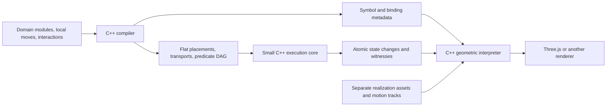

# A compositional puzzle language and a domain-free core

**Design and migration plan — 17 October 2026**

Status: implementation started. The expanded JSON AST, independent toy-model oracle, domain-free C++ executor, and cube/bandage authoring libraries are implemented through an additive experimental API. Those two models have passed the native/WASM abstract-migration gate; the application/session/interpreter cutover remains ahead. See the [implementation and API guide](relational-core.md). The design uses general permission relations `R(s, u, a1, ..., an)` and keeps completion selection outside the executor. It replaces the direction of the domain-aware rule backends in Sections 2–6 of the [architecture proposal](../twisty_puzzle_simulator_architecture.md). The portable C++ kernel and separate geometric realizations remain the project boundary.

## 1. The intended split

Domains belong to the **definition language and compiler**. The executing core sees persistent piece indices, one flat catalog of exact placements, finite transport tables, and one predicate program. It has no corner, edge, face, gear, footprint, domain, or puzzle-specific guard dispatch.

The language describes three things separately:

1. Local placement catalogs and movements within a domain.
2. Requests that name an intent and constrain possible tuples of local movements.
3. Relations that specify which movement tuples a request permits in a state.

The compiler expands these descriptions into a flat, domain-free program. A request together with a permitted local-movement tuple produces one atomic transition. Request completion is explicit: a general relation may permit multiple tuples and does not itself select one. Geometry, rotation angles, meshes, and continuous collision checks remain outside this language and the abstract core.



This is a replacement of the current execution model, rather than another rule-module case added beside the existing ones.

## 2. What must change in the current implementation

The current [core.hpp](../include/twisty/core.hpp) stores `Domain`, `Piece::domain`, domain-indexed transport/role arrays, `piece_guards`, `placement_count_guards`, and mechanism guard/update records. [core.cpp](../src/core.cpp) branches between footprint and placement-relation rules and evaluates those guard forms separately. Even state validation uses domain-specific placement ranges and occupancy behavior selected by the rule module.

The migration must replace all of those execution paths, including state validation and goal checking. Merely flattening `Operation::maps` would leave most of the old abstraction in place.

| Existing use | New authoring description | New execution representation |
| --- | --- | --- |
| Cube face turns | Parallel corner, edge, and face movements | Enabled flat transports |
| Bandage partial-overlap rule | A finite blocking relation or rigid compound module | A predicate over placements and selected movements |
| Helicopter source-phase guards | Membership of a mechanism piece in a phase set | The same predicate representation |
| Helicopter/Bagua blocked placements | Interactions between placement sets and local movements | The same predicate representation |
| Gear middle-layer count | Count of pieces in a named placement set | The same predicate representation |
| Gear coupled operation construction | A relation between the face, opposite-face, and cog movement choices | Choice predicates, the common permission evaluator, and flat transports |
| Occupancy and exclusion resources | Declarative state invariants | The same predicate representation |
| Finite mechanism variables | Auxiliary pieces with finite placement catalogs | Ordinary entries in the state vector |

The geometric interpreters also read `Definition::domains`, `Piece::domain`, `Operation::roles`, and per-domain frames directly. Replacing those dependencies is part of this project, even though the existing meshes and continuous motion conventions should be retained.

## 3. Flat placements and state

For authoring catalogs `Q1, ..., Qd`, compile their **disjoint union**:

```text
Q = Q1 ⊔ Q2 ⊔ ... ⊔ Qd
state[pieceIndex] = globalPlacementIndex
```

The disjoint union gives different IDs to equal-looking local names from different modules. It is a sum of catalogs, not a Cartesian product of catalogs or an enumeration of complete puzzle states. Here, “flat placement catalog” means this disjoint union.

For example, the current 3×3 has 54 placements: 24 corner, 24 edge, and 6 center placements. The Helicopter has 420: 240 corner, 144 triangular-center, and 36 hidden mechanism placements. Those become single indexed catalogs; their module origins are unnecessary for execution.

Recommended runtime state:

```text
State {
    placementOf[pieceCount] : PlacementIndex
}
```

A piece has no runtime `domain` or `type` field. Its allowed placements are expressed by an ordinary invariant, such as `at(piece, allowedSet)`. This is important for imported states: flattening must not accidentally permit an edge identity to occupy a corner placement. The restriction is data evaluated by the common predicate program, rather than a special type-compatibility check.

Finite hidden modes use auxiliary pieces with their own allowed sets. The Helicopter's twelve axis mechanisms can be authored through one mechanism module, with each piece restricted to its three appropriate placements. All shipped definitions currently have empty separate mechanism records. The new language will not promise arbitrary JSON-valued runtime variables; a legacy nonempty record needs an explicit finite encoding or a conversion error.

Piece names, placement names, port labels, module names, and domain groupings remain available in compiler-produced metadata. They are useful to codecs, inspectors, and realizations, but do not select an execution algorithm. Auxiliary pieces remain part of exact state identity even when no realization displays them.

## 4. The definition language

### 4.1 A small language with one canonical AST

Use a declarative textual format, provisionally `.pzl`, backed by a versioned JSON AST. Implement both front ends through the same C++ compiler. The AST comes first so the semantics and lowering can be tested before investing in parser conveniences; the textual front end is part of the planned delivery, not a separate rule system.

The language needs the following constructs:

| Construct | Purpose |
| --- | --- |
| Finite sets, records, and tables | Name pieces, placements, ports, and relations |
| Domain/module instantiation | Reuse a catalog and its local movement definitions |
| Local movement | An explicit support, exact transport, local requirements, and an opaque event label |
| Parallel bundle | Name a simultaneous local movement or an exact tuple/profile |
| Interaction relation | A Boolean formula `R(s, u, a1, ..., an)` describing permitted tuples |
| Blocking/forcing notation | Optional abbreviations for clauses of an interaction relation |
| Invariant and goal | Predicates expressed in the common expression language |
| Finite templates and loops | Expand symmetry families and repeated declarations at compile time |

Finite group actions and coset generation remain compiler/library conveniences. Imported Helicopter and Bagua catalogs may still be generated by their existing offline tools, but their language inputs must contain only exact abstract data. No geometry, application callbacks, general scripting, or runtime plug-ins are required to execute a definition.

A local transport is a finite one-to-one map on an explicitly declared support. It must supply a target for every supported source. Outside the support it does not participate. Missing rows must not ambiguously mean either “stationary” or “blocked”; blocking is an explicit requirement or interaction.

Support can contain a self-loop `q -> q`. That still records participation and an event. Featureless cube centers and full-turn paths make this distinction necessary.

A local choice set contains an explicit idle movement. A choice may also name a finite simultaneous composition of local primitives, such as a face movement together with an opposite-face movement within one domain. This permits multiple local primitives without redefining an interaction as a subset-activation algorithm. Composite choices have explicit transport and event semantics; conflicting local writes need an authored composition.

A named bundle is a convenience for describing a movement or exact tuple/profile. It carries no implicit least-closure, priority, or movement-selection semantics.

### 4.2 Cube composition

Illustrative syntax, not an implemented parser contract:

```text
puzzle Cube3 {
    use CubeCorners as corners;
    use CubeEdges   as edges;
    use CubeFaces   as faces;

    for f in cubeFaces {
        request turn[f] = parallel(
            corners.turn[f], edges.turn[f], faces.turn[f]
        );
    }
}
```

There are no cross-domain movement interactions in this example. The request simply selects three independent local movements. Piece compatibility and occupancy remain declared invariants, even when their preservation follows automatically from the movement tables.

Formally, the request's tuple constraint is `a_corners = corners.turn[f] and a_edges = edges.turn[f] and a_faces = faces.turn[f]`. The fixed `parallel` syntax abbreviates this exact relation.

### 4.3 Helicopter composition and jumbling

Author three conceptual families: corners, triangular centers, and axis mechanisms. A directed request selects the appropriate local movements from all three. A source-phase requirement is a placement-membership predicate on the appropriate mechanism piece.

An interaction clause can say:

```text
relation centerObstruction(s, u, a) =
    chosen(a.corners, corners.turn[axis, from, to])
    implies not any(centers.pieces,
                    p => at(s, p, centers.blocking[axis, from, to]));
```

The other required blocking directions use the same relational construct. The actual sets come from the existing exact catalog and obstruction relations; this sketch does not replace their derivation. A tuple selecting an obstructed movement is forbidden as a whole. The compiler does not silently delete that movement and execute the rest.

This expresses cross-domain obstruction without teaching the core what jumbling, a cut, a triangular center, or a source phase means. Exclusion resources likewise become finite cardinality invariants, without pretending those resources are geometric voxels.

### 4.4 Gear composition and conditional coupling

Separate local face movements from local cog-phase movements. Instantiate geared and plain edge modules according to the selected persistent piece identities. Detect middle-layer cogs from their **current placements**, including all applicable carrier orientations and phases.

```text
let g(s, f) = any(geared.pieces,
                  p => at(s, p, geared.middle[axis(f)]));

// Each profile specifies one local choice per participating domain.
// A local choice may be a named simultaneous composition.
relation gearFace(s, u, a) =
    (u == ordinary[f, d] and not g(s, f)
                         and a == ordinaryProfile[f, d])
    or
    (u == coupled[f, d]  and g(s, f)
                         and a == coupledProfile[f, d]);
```

`ordinaryProfile` contains only the requested face movements. `coupledProfile` also contains the prescribed opposite-face movements and every applicable middle cog-phase movement. Plain middle pieces remain stationary. Mixed geared/plain middle layers are permitted. The exact profiles also exclude unrelated extra movements; an implication that merely requires the cog motion would not establish this exclusion.

The opposite-face movement in each profile is an explicitly authored library table using the current canonical opposite-pair convention. It is not an instruction to infer a direction from a face name or port ordering. Coupled `R = L`, `U = D`, and `F = B` must remain identical, including cog phases and the interpreter's signed motion paths.

Preserve the existing public requests during migration: `Fq` names the ordinary case and `F` names the coupled case. These cases have fixed profiles whenever permitted, so state-dependent per-action selection need not repeat their request conditions. A new automatic request could permit the appropriate profile through a state-conditioned disjunction, but the core migration must not silently change notation or saved-history behavior.

The abstract cog update remains a phase transport. The existing full signed 300° animation belongs to the realization and its event binding, not to the definition language.

### 4.5 Bandaging

First preserve the current 25-piece bandaged definition, including its single compound identity. Its compound placements and blocked supports can be imported as ordinary finite module data. No footprint evaluator remains in the new core.

A later authoring convenience may retain separate identities and declare a rigid compatibility relation. Merely forcing two pieces to move together is insufficient to establish a rigid bandage: their relative placements and allowed movement combinations must also agree with that relation. Do not change piece identity counts as an incidental part of this migration.

## 5. Interactions as permission relations

Let `S` be the valid abstract states, `U` the requests, and `Ai` the finite local movement choices for authoring domain or channel `i`. Every `Ai` includes an idle choice. A local choice may be a declared simultaneous composition when that domain needs several primitive movements in one step.

An interaction is a relation

```text
R ⊆ S × U × A1 × ... × An

R(s, u, a1, ..., an)
    = in state s, request u permits this tuple of local movements
```

The tuple describes simultaneous movements evaluated against the same source state. Local transport tables determine its tentative effect `T_a(s)` and event witness. Neither this Cartesian product in the mathematical signature nor a tuple's existence requires enumerating every tuple or complete state in storage.

Authors can compose interaction clauses by ordinary Boolean expressions. Their conjunction, the request's own tuple restrictions, local applicability, compatible writes, and target-state validity give the complete permission relation:

```text
R(s, u, a) = requestConstraint(s, u, a)
            and all authored interaction clauses(s, u, a)
            and localApplicable(s, a)
            and compatibleWrites(s, a)
            and valid(T_a(s))
```

An undefined or conflicting simultaneous transport makes the tuple forbidden. State validity is checked separately on supplied input; `s` must belong to `S`.

This generalizes blocking and forcing to arbitrary finite constraints on movement choices:

| Interaction | Example clause |
| --- | --- |
| Obstruction | `blocked(s) implies ai != move_i` |
| Conditional forcing | `(ai == move_i and condition(s)) implies aj == move_j` |
| Synchronization | `(ai == move_i) iff (aj == move_j)` |
| Mutual exclusion | `not (ai == move_i and aj == move_j)` |
| Alternative movements | `exactly(1, [ai == move_i, aj == move_j])` |
| Multiway coupling | `exactly(2, [ai == move_i, aj == move_j, ak == move_k])` |
| Conditional exact coupling | When the requested driver is selected, `aj == move_j iff condition(s)`; otherwise `aj` is idle |

`block` and `force`, if exposed as convenience syntax, abbreviate such clauses. They are not the language's fundamental interaction categories. General negation, alternatives, and non-monotone constraints on choices are permitted.

An implication requiring `b` whenever `a` is selected does not prohibit `b` by itself. To exclude unrelated extra movements, the request or relation must also restrict those choices. Likewise, mutually requiring `a` and `b` permits both idle or both selected unless another clause decides between them. There is **no implicit least-closure or declaration-order rule**. A positive-closure recipe may remain an explicitly named library convenience, whose exact tuple semantics must be defined and checked against `R`.

## 6. Permission and tuple selection are separate

For a given source and request, define the permitted completions:

```text
Allowed(s, u) = { a ∈ A1 × ... × An | R(s, u, a) }
```

There can be no completion, one completion, or several. A permission relation is not generally a function selecting a tuple.

Recommended execution contract:

1. The small core validates a **fully specified** request: public request ID plus an encoded local-movement tuple. It checks permission and produces the corresponding flat transition. No search is needed to check a supplied tuple.
2. A compiler-produced request binder may supply a known unique tuple, evaluate an explicit default selector, or expose declared alternatives. This layer is separate from the relation's meaning.
3. A request without a completion must not silently pick the first satisfying tuple, add all permitted movements, or take an assumed least solution. It returns a choice requirement unless its binder can determine a completion under a documented policy.

For existing fixed or state-conditioned recipes, the compiler can derive completion expressions or a small list of guarded profiles. The old `plan(s, u)` convenience API remains usable for these requests. Each generated completion is still validated against `R`. Obvious repeated tests can be simplified: once a coupled `F` request is permitted, its required cog and opposite-face movements are unconditional within that completion.

For a general relation, allow callers to provide a complete tuple/opaque completion token directly. An author may also declare a default selector without removing other permitted tuples from the relation. If a selected completion fails validation, report rejection of **that completion**; this alone does not prove that `Allowed(s, u)` is empty.

The distinction also affects discovery APIs. Declared finite profiles can be tested directly; a general `legalCompletions(s, u, limit)` helper must report whether its results are complete or truncated. A bounded search finding no completion must not report that no permitted tuple exists unless the search was exhaustive. The existing shipped requests must retain exact legal-request listings through their compiled binders.

Synthesizing selectors or enumerating all satisfying tuples can be expensive for arbitrary finite relations. The compiler may exploit structure or perform bounded analysis, but the language's relational expressiveness does not depend on a generic automatic solver. Automatic completion may be unavailable while direct membership checking remains supported. The core contains no SAT solver or runtime rule-closure engine.

Different permitted tuples remain distinct even if they produce the same target placements. Their selected events or winding paths may differ. Replay stores the actual completion and checks it again rather than choosing a new tuple from the target state.

## 7. One predicate representation and flat execution

### 7.1 The common predicate graph

Use a shared, acyclic graph with two node forms and two reserved constant references:

```text
IN(inputBank, inputIndex, finiteSetId)
RANGE(lower, upper, childReferences)

FALSE, TRUE
```

`IN` reads a finite value from an input bank and tests membership in an interned set. With the state bank, the index denotes a piece and the value is its global placement. With the choice bank, the values encode the supplied movement tuple. The request ID can usually be specialized into the selected request program. Compiler typing prevents confusing placements with movement choices; the evaluator only handles finite numeric inputs.

This extends the earlier state-only `IN` proposal so the same graph can express `R(s, u, a)`, not just tests on `s`. Encoding choice inputs as generic bits/finite values erases the authoring domains. These inputs are temporary evaluation data, not additional pieces in the persistent puzzle state.

`RANGE` tests whether the number of true children lies in an inclusive interval. Its child list preserves multiplicity where distinct counted terms happen to share a simplified expression.

```text
not x             = RANGE(0, 0, [x])
all(x1, ..., xn)   = RANGE(n, n, [x1, ..., xn])
any(x1, ..., xn)   = RANGE(1, n, [x1, ..., xn])
at_most_one(xs)    = RANGE(0, 1, xs)
exactly(k, xs)     = RANGE(k, k, xs)
x implies y       = any(not x, y)
```

Finite quantifiers and tuple tests lower to these nodes. Empty `all`/`any` and impossible intervals fold to constants. The dual occupancy predicate also uses the same graph: `occupiedBy(q, P)` is `any(p in P, IN(state, p, {q}))`; exactly one matching piece uses range `1..1`.

Movement equalities such as `ai == move_i` become tests on choice inputs. Implications, equivalences, alternatives, and cyclic *logical constraints* are then ordinary acyclic expressions over supplied values. They do not require iterative activation propagation. A genuinely recursive predicate definition is a different issue and is rejected unless expanded through an explicitly defined finite construction.

There are no `FootprintGuard`, `PieceGuard`, `CountGuard`, `MechanismGuard`, or interaction-kind handlers. The same evaluator handles state facts, choice constraints, local applicability, safety predicates, invariants, and goals. Source metadata maps roots back to authored clauses and explains a rejected completion.

### 7.2 Compiled definition

Recommended execution data, with symbols and request-completion conveniences kept in a companion package:

```text
KernelDefinition {
    pieceCount; placementCount;
    initialPlacements[];
    internedFiniteSets[];  // formerly placement-only sets; also used for choice inputs
    predicateNodes[]; childReferences[];
    transportMaps[];       // sparse global-placement -> global-placement rows
    actionRecords[];       // pieceIndex, mapId, selectionRoot, opaqueEventId
    requestPrograms[];     // choice-input shape, action range, relationRoot
    invariantRoot; goalRoot;
}
```

`relationRoot` holds the request-specific clauses and local/write applicability checks. The common source/target state-invariant checks factor out the universal validity conditions of the full semantic relation `R`; they are not additional interaction types.

Each action record refers directly to one piece index. Its `selectionRoot` determines whether the supplied completion includes that potential movement. This refines the old `activationRoot` terminology: the expression decodes the chosen tuple, while the relation decides whether that tuple is permitted. Many records share a transport map and selection expression. Domain tables are unnecessary to apply them.

A map row explicitly records participation, including self-loops. Absence of a row means no participation for that record at that placement. Sparse rows avoid stationary entries across the entire catalog. Compiler-provided fixed profiles can fold selection roots to constants, with no duplicate permission tests.

`invariantRoot` is one state-validity expression evaluated on both source and candidate states. `goalRoot` tests the current state for completion and does not restrict legal movement. Separate source/target invariant fields are unnecessary.

### 7.3 Atomic execution

Given a source, request ID, and complete choice inputs, the core:

1. Checks structural input bounds and the source state invariant.
2. Evaluates the request's relation clauses using the unchanged source and supplied choices.
3. Collects the selected transport rows against the original state.
4. Builds one tentative target and an event witness, without changing the session.
5. Evaluates the same state invariant on the target, completing the permission check.
6. Returns the complete plan or a rejected-completion result. The session performs one revision-checked commit.

The compiler lowers conflicting writes to ordinary at-most-one predicates. Parallel movements do not apply to one another's intermediate results, and conflicts are not settled by declaration order. A shared named primitive selected through multiple references executes once. Distinct movements writing the same piece need explicit exclusion or an authored composition. Equal endpoints alone do not justify merging different events. Structurally malformed programs remain errors.

A forbidden candidate tuple, including a target-invariant failure, is rejected without committing. An invalid supplied state, malformed choice encoding, or invalid program is an input/program error. Rejection of one tuple is distinct from proof that the unresolved request has no completion.

The witness retains the public request and concrete completion, plus every participating piece, source/target placement, and event, including self-loops. Selection and interaction checks are not rerun using the target as the source during animation. State invariants do not depend on ephemeral choice inputs.

### 7.4 Packing and performance

Use dense IDs, interned sets/maps, shared predicate nodes, and contiguous reference arrays. Choose sparse sets or bitsets by measured size. Hash the normalized relation and event semantics before storage choices; packing offsets and formatting do not define meaning.

Factor relations and finite lookup tables instead of emitting truth tables for the Cartesian product of choices or states. No representation is guaranteed compact for every finite relation. Reject excessive expansion with a clear diagnostic; do not silently reduce the language to positive forcing.

Evaluation caches must account for the request and completion as well as the source state. State-only facts can be shared across tuple checks, and invariants/goals can use state-only caching. Rebinding the invariant evaluator to a candidate state must not reuse stale source-state results.

Benchmark compiled size, compiler memory, membership-check latency, binding/completion cost, and exact legal-request listing on cube, Helicopter, Gear, and the larger Bagua model. Measure relation checking separately from optional search. The minimal core should remain fast even when finding a permitted completion is difficult.

## 8. Compiler pipeline

1. Parse text or JSON into the same typed AST; resolve imports and qualified symbols.
2. Expand finite templates, group actions, local catalogs, and named relations.
3. Validate local supports, transport totality on support, and explicit inverse references.
4. Form the disjoint placement union and stable piece indices.
5. Encode the local choices as finite input values/bits and lower arbitrary relational clauses, local requirements, write compatibility, invariants, and goals to the common predicate IR.
6. Compile declared exact profiles, derivable unique completions, or explicit default selectors into request binders where available. Do not assume the relation is functional or replace it by positive closure.
7. Emit per-piece action records sharing sparse maps, choice-selection expressions, and event references.
8. Simplify and intern sets, nodes, maps, and common request subgraphs.
9. Validate bounds, input-bank dependencies, acyclicity, initial-state invariants, and the binder's declared coverage. A binder must not claim to enumerate every completion without justification.
10. Emit the execution program, normalized serialization, source map, request binders, and separate symbol/binding metadata.

Inverse local tables do not by themselves prove inverse **permitted completions**. For each declared inverse correspondence, check that `R(s, u, a)` implies permission of the inverse tuple under the inverse request at `T_a(s)`, and that the inverse restores the state with the appropriate inverse events. The concrete tuple matters when a request permits alternatives. Check local tables exactly, then verify the full relation through source semantics, toy exhaustive models, and puzzle-specific derivations/differential checks. Bounded symbolic proofs may strengthen this; tests must not be described as exhaustive proofs over a large puzzle's reachable states.

The compiler is portable C++. Existing Python tools may continue producing finite source catalogs and independent test oracles; they are not runtime rule providers.

## 9. Diagnostics, serialization, and realization bindings

Every authored requirement and relation clause has a stable source ID. The compiler maps predicate roots to those IDs and relevant piece, placement, and movement-choice names. A rejected completion produces a uniform constraint result with source location, the chosen tuple, and matched facts or count bounds. Failure of one completion is not an explanation of unsatisfiability of the whole unresolved request. The core must not switch on human-readable reason IDs to determine behavior.

Separate the execution definition from an `AuthoringBindings` catalog containing stable symbolic IDs, local ports and labels, source grouping annotations, movement/completion names, and event names. Domain names may still appear in the inspector and authoring UI through this metadata. Renaming or regrouping authoring modules must not require a new core execution mechanism. An author-declared default selector is semantic package data and must be covered by the appropriate package identity; it is not merely an unhashed debug annotation.

The geometric interpreter resolves its models, placement frames, visual components, and operation tracks through flat IDs and these bindings. Existing domain-grouped realization files may initially be converted by a package adapter; that adapter must not recreate domain-aware move planning inside the core.

Preserve the current meshes and motion conventions. In particular, do not infer cog winding or center participation from endpoint state differences. Independent renderers continue consuming interpreter assets, normal buffers, and sampled frames. Controllers may present or submit completion choices, but do not duplicate the relation's abstract permission checks.

Version these contracts independently:

| Contract | Proposed migration decision |
| --- | --- |
| Language/AST | New language version 1, with a new source-kind identifier |
| Compiled definition | New flat format, separate from existing definition schema 1 |
| Predicate instruction format | Explicit version 1 within the new format |
| Public kernel API | Version 2 for breaking definition/state contracts and explicit completed-request, discovery, and witness contracts |
| Frame buffer layout | Retain version 1 while its existing layout is unchanged |
| Realization/session documents | Version or explicitly adapt each affected contract; never reinterpret an old document silently |

Keep stable public piece/request names where possible. Dense-index changes are implementation details. Compiled definition digests will change with the new canonical representation; behavioral parity must compare states through the symbol mapping, not assume identical digest strings. Equivalent source programs are not promised the same digest merely because they compute the same Boolean function.

Provide an explicit legacy converter for existing source/compiled packages and saved sessions. Old request-only histories need their known completions reconstructed and validated during replay. New histories record the completion so replay never depends on choosing an alternative again. Rebind realization digests only after the puzzle's parity gate passes; do not bypass a mismatch by replacing a digest string alone.

## 10. Implementation milestones

| Milestone | Deliverable | Completion gate |
| --- | --- | --- |
| 0. Freeze the specification | General `R(s, u, a)`, tuple/completion semantics, flat IR, inverse expectations, examples, and existing-model baselines | Examples cover zero, one, and multiple permitted tuples, with explicit targets and witnesses |
| 1. Build an authoring oracle | Canonical JSON AST and an independent relation evaluator; exhaustive tuple enumeration only for tiny models | Arbitrary Boolean interactions agree with their mathematical relations, including cyclic constraints and alternatives |
| 2. Implement the flat executor | Domain-free C++ structures, finite-input `IN`/`RANGE` evaluation, complete-request validation, transport application, and witnesses | Given a tuple, the executor matches the relation oracle without invoking old rule modules or a solver |
| 3. Implement the compiler and initial library | Relational lowering, finite expansion, profile/binder generation, then the textual parser; cube and compound-bandage modules | Both puzzles preserve legal requests, identities, states, and participation behavior through exact completions |
| 4. Migrate interacting puzzles | Helicopter, Gear variants/custom masks, then Bagua, expressed through the general relation | Cross-blocking, conditional coupling, exact permitted profiles, and existing regression fixtures agree |
| 5. Adapt the portable product | Sessions, codecs, interpreter bindings, public native/WASM declarations, independent examples, and the reference app | All existing views and controls work through the new public API and flat witnesses |
| 6. Retire old execution paths | Remove runtime domain fields and the old guard/footprint/relation planners; retain a clearly isolated converter if needed | Only the flat executor is used by production planning and state validation |

During migration, keep the old executor available as a **test oracle**, not as a permanent fallback hidden inside the new core. Do not switch a preset to the new format until its relevant gates pass.

### Initial implementation progress

- Milestone 1's expanded JSON AST and independent source evaluator are implemented. Tiny models cover zero, one, and multiple permitted completions, cyclic constraints, arbitrary Boolean choices, occupancy, and different events with identical targets.
- Milestone 2's flat executor is implemented in `Twisty::flat_core`, independently of JSON, authoring domains, geometry, and the existing executor. It validates supplied tuples and returns atomic transitions with complete witnesses.
- The compiler lowering needed for those gates is implemented in `Twisty::relational`: disjoint catalogs, typed expressions, shared sets/maps/nodes, exact local transports, and explicit profiles. Profile binding and bounded discovery are separate helpers.
- Milestone 3's cube/bandage libraries and native parity gate are implemented. The libraries directly generate standard ASTs and separate port/event catalogs through finite symmetry expansion; they never invoke the old executor. All local tables, all 24 whole-cube orientations, sampled walks, inverse completions, full witnesses, and imported assignment mutations are compared against the existing definitions. Textual syntax and general module/template facilities remain.
- Native and WASM consumers retain the experimental relational version 1 API alongside public API 2. The cube/bandage integration batch adds persisted packages and semantic identities, complete-tuple session replay, explicit legacy-save conversion, and a shared session/interpreter execution context. Richer source diagnostics, textual syntax, and general adapters remain.
- All production presets now use the flat executor after their parity gates: cube, bandage, Helicopter, Gear variants/custom masks, and Bagua. Uniform and articulated event adapters preserve the existing views. Explicit legacy document kinds remain isolated compatibility/import and comparison paths; the new executor never calls them as a fallback.

Initial validation: all 12 native tests and 39 unit tests pass. An independent source evaluator agrees with both native and WASM execution on 13,254 state/tuple/witness checks across 34 tiny models. Installed native and copied WASM consumers also agree. Existing-puzzle regression passes describe the current production executor; they are not evidence that those presets have already migrated. Builds and heavy checks ran sequentially with one build job, peaking at approximately 2.5 GiB of container memory.

Cube/bandage migration validation: all 14 native tests and 39 unit tests pass. The new parity gate covers every local transport, all 24 global orientations, and 160 sampled walk steps per model, plus assignment mutations and incorrect completions. Its 1,944 exported reference cases also agree in WASM. Installed native and copied SDK consumers reproduce both libraries and execute their migrated definitions. The observed container-memory peak during these sequential checks was approximately 2.8 GiB. This completes the first abstract-definition migration batch; it does not switch the reference application's sessions or interpreters.

### Required regression coverage

- **Uniform predicates:** state and choice membership, dual occupancy queries, equality, general negation, equivalence, nested expressions, counts, occupancy/exclusion, allowed placements, invariants, and goals use the same evaluator.
- **General relations:** obstruction, synchronization, mutual exclusion, alternatives, multiway counts, and conditional coupling; states/requests with zero, one, or multiple completions. No implicit least solution or declaration priority is allowed.
- **Cyclic constraints:** mutually requiring movements may have multiple satisfying tuples; contradictory choice constraints may have none. Checking a supplied assignment must not depend on an iterative activation order.
- **Atomic execution:** repeated references to one movement, rejection of an entire forbidden tuple, conflicting writers, and source conditions that change after transport. No partial commit is allowed.
- **Completion and replay:** explicit choices, exact binders, declared default policies, truncated discovery, rejection of one choice without claiming no others exist, and distinct event tuples sharing a target state.
- **Cube/bandage:** all face turns and inverses; unchanged center participants; the existing compound identity and partial-overlap behavior.
- **Helicopter:** all stop/source-phase conventions, cross-family blockers, hidden axis restrictions, invalid imported assignments, and existing shape-graph fixtures. Flattening must not merge the twelve mechanism identities or their allowed phase sets.
- **Gear:** normal, Extreme, all-plain, and custom masks; zero through four middle cogs; masks containing only UF or only UF/UR; every axis and inverse; coupled opposite-request equivalence; the F/UR direction regression; and complete cog phase/winding witnesses.
- **Bagua:** existing piece cycles, cut/block relations, occupancy exclusions, inverse sequences, and the larger catalog's resource usage.
- **Integration:** pure planning, stale revisions, undo/redo, seeded scramble reproducibility, session replay/conversion, all realization choices, and independent installed native/WASM consumers.

Use exhaustive state and tuple enumeration for deliberately small examples. For shipped puzzles, compare mapped legacy/new states, exact legal requests through their binders, and full completion/event witnesses along existing fixtures and seeded walks, supplemented by targeted invalid assignments. Record where coverage is sampled rather than proved.

## 11. Scope and first implementation target

The first implementation should establish the relational AST, the two-node finite-input predicate IR, and a domain-free validator of supplied movement tuples. Tiny independent, blocking, synchronizing, alternative, and coupled examples must come before automatic completion conveniences. Then migrate cube and bandage before touching the more complicated catalogs or interpreter bindings.

V1 is deliberately finite. Infinite/symbolic placement algebras, continuous logical states, runtime scripting, a general automatic relation solver, and an interactive language editor are outside this change. Arbitrary finite Boolean relations on the supplied choices are supported, including non-monotone and alternative-choice constraints. Checking permission does not require solving for a choice. Completeness or physical correctness of a puzzle's authored catalog remains a separate obligation.

The final acceptance criterion is architectural: a new finite puzzle with new authoring domains and new combinations of the existing interaction constructs must require **no new core structures, guard classes, or puzzle-specific branches**. Its differences belong in language data, reusable compiler libraries, and its separate geometric realization.


### Cube/bandage session and interpreter integration

An explicit `Execution` adapter now joins symbolic wire states, compiler bindings, flat execution, and existing port frames. It reuses grouped tables only as interpreter/inspector metadata; it never invokes old rule checks for a relational document. API 2 introduces new semantic identities, persisted definition format 1, and schema-2 histories with completed tuples. Undo/redo and replay preserve choices and participation events, including self-loops and alternatives with identical endpoints. An explicit converter verifies old histories before returning schema-2 documents.

The cube and bandage presets, default CLI, and independent Canvas example use `relational-package.json` and newly pinned realization documents. The original package definitions remain available as comparison oracles and explicit imports. Meshes and camera controls are unchanged. Native integration checks cover source/compiled round trips, pure planning, state validity, authored goals/interactions, all three realization endpoints, rejected/tampered witnesses, revisions, transactional rollback, seeded walks, completion-preserving replay, and legacy conversion with redo tails. Remaining integration work includes the interacting-puzzle authoring libraries and more general event/frame adapters; the uniform adapters intentionally reject other event paths.

Integration validation: 15 native tests and 39 unit tests pass. Native/WASM comparison retains the 13,254 independent-oracle cases and 1,944 cube/bandage reference cases, and adds complete session witnesses, recorded-choice replay, and explicit legacy conversion. Installed native and copied SDK consumers agree across all 19 puzzle/view combinations. All 32 browser cases pass: 31 in the full run, and the cold-start case on a fresh-browser rerun after increasing the kernel-initialization wait from 5 to 15 seconds. Builds and heavy checks ran sequentially with one build/browser worker. Successful verification jobs peaked at approximately 3.1 GiB; the memory guard stopped earlier builds safely while cache was reclaimed before continuing.


### Helicopter puzzle migration

Helicopter now uses three authoring domains (center, corner, mechanism), flattened to 420 placements for 44 persistent identities and 180 directed stop requests. All twelve mechanism identities retain their separate three-phase axis restrictions through ordinary membership invariants. Shared occupancy predicates express capacities, pair exclusions, and cross-domain obstruction; no core guard structures or predicate opcodes were added. Default profiles follow the current source phase, while the relation independently rejects incorrect supplied tuples.

The uniform port adapter preserves the original meshes and animation events in all three views. Inspector/frame grouping is metadata; planning and state validation use only the flat executor. Candidate defaults are exposed separately from accepted requests for phase-aware controls. Rejection highlighting follows a Boolean proof through the generic predicate trace in the separate completion helper.

The parity gate compares local tables, single-piece mutations, all directed requests over sampled walks, every source phase, full witnesses, inverses, replay, explicit legacy-save conversion, and unchanged sampled interpreter poses. Existing legacy definitions and shape-graph verification remain comparison tools. Gear variants/custom masks and Bagua have also passed their migration gates. Articulated per-piece event binding is described below; legacy production defaults have been retired.

Helicopter migration validation: all 17 native tests and 39 unit tests pass. The new native gate passes 182,711 checks, and 775 exported reference cases agree in WASM alongside the existing 13,254 independent-oracle and 1,944 cube/bandage cases. Persisted definitions, recorded-choice replay, and explicit legacy conversion agree across native and WASM. All 19 installed/copied SDK puzzle/view comparisons pass. All 32 browser cases pass: 31 in the full run and the Canvas case in a focused rerun after changing its CLI query to return a snapshot instead of exceeding Node's output-capture limit with the full compiled definition. The generation gate also tests fresh temporary source artifacts before replacing checked-in sources or pins. Reproducibility checks and the production build pass. Heavy work ran sequentially with one build/browser worker, with observed container memory peaking at approximately 3.1 GiB.

### Elongated bandage follow-up (implemented)

With the Gear variants/custom masks and Bagua migrated, the `bandage/UF-UFR` model is now visibly continuous in Euclidean and spherical views. Its single cuboid replaces the previous two bodies and connecting bridge; shared spherical seam vertices replace the separate inset patches. The requirements below are implemented.

- Replace the Euclidean bodies and bridge with one cuboid spanning the adjacent UF and UFR cells. Keep the surrounding piece clearance and use a shared, economical mesh. Derive its rigid placement frame from the compound's existing attachments so every placement and turn uses the same model.
- Join adjacent patches of the same face color across the internal seam. Preserve the five abstract ports and their picking bindings, including when adjacent colored patches meet without a visible gap.
- Give the spherical view a corresponding continuous compound surface, respecting the actual disk boundaries and inherited rotation tracks. Its shape must come from the spherical regions, rather than simply projecting the Euclidean cuboid onto the sphere.
- Generate models, frames, and hit bindings in the C++ interpreter for native and WASM clients. Three.js and the independent renderer continue consuming the public assets and frames.
- Keep the existing 25 identities, abstract placements, permission predicates, goals, and saved logical histories. Check rigid motion and endpoint continuity through legal turns and inverses, then review both views in the browser before committing the model change.

This geometry task follows the remaining puzzle migration gates; it does not delay or replace them.


### Gear-family puzzle migration

The new portable Gear library reuses cube symmetry authoring and emits the common language for normal, Extreme, all-plain, and arbitrary masks. It preserves 26 identities, 198 placements, both opposite-face motions, intrinsic phase handedness, and occupancy across plain/geared domains. Middle-slice coupling is a count condition on the complete local tuple; the executor is unchanged.

Articulated catalogs add reciprocal local inverses and certificates mapping opaque local events to existing request-track tables. The interpreter dispatches per participant after validating the full event witness. Existing meshes, winding, and pivots remain in realization data. A synthetic alternative completion checks simultaneous F and R local tracks, guarding against reuse of a single global animation track. Sessions and legacy conversion preserve recorded local choices.

The native gate covers all local entries, assignment mutations, sampled walks, and seven geometric models across 29 masks, including the previously problematic UF-only and UF/UR configurations. It also checks exact witnesses, inverse restoration, persisted definitions, replay, and conversion with redo tails. Production presets and custom-mask controls use the explicit new source kind; legacy authoring remains explicit for comparison and conversion. Bagua has also migrated, retiring the remaining legacy production default. The elongated bandage model is implemented afterward; explicit legacy compatibility paths remain isolated.


### Bagua and production-path migration

Bagua now lowers its eight authoring catalogs to 2,232 placements for 146 identities and 30 complete requests. Shared memberships, occupancy counts, and Boolean request relations express exclusions and cut blocking through the existing two predicate instructions. Its native gate passes 166,569 checks against the previous executor, including exact maps, source mutations, sampled walks, full witnesses, inverses, sessions, legacy conversion, and all three unchanged realizations. Named-predicate compilation caches prevent repeated expansion while retaining request specialization and state-only/depth checks.

Every production preset, including custom Gear masks, now selects the flat executor. The app and independent client use new packages and pins; explicitly imported legacy formats remain isolated compatibility paths and comparison oracles. This retires the legacy production defaults without silently changing old document meanings. Physical deletion of compatibility code is deferred until legacy import support is deliberately removed. Textual syntax, general module/template facilities, and richer source diagnostics remain language follow-ups. The following section records the completed elongated bandage geometry follow-up.


### Elongated bandage realization

The requested geometry follow-up replaces the two Euclidean cube bodies and bridge with a single 24-vertex cuboid. Same-color stickers join across the seam while retaining all five port IDs. Spherical ports are tessellated as inset unions, then split at their original internal small circle using shared intersection vertices. This keeps the disk arrangement and picking memberships, removes the visible internal gap, and uses the existing tessellation density. Abstract state, relations, identities, and saved histories are unchanged. Both models remain uncommitted for browser review.


### Interacting-puzzle and model validation

All 20 native tests and 40 unit tests pass. The independent source oracle contributes 13,254 checks; exported cube/bandage, Helicopter, Gear, and Bagua suites add 1,944, 775, 360, and 185 exact native/WASM comparisons. Installed native and copied WASM consumers agree across all 19 puzzle/view combinations, including custom Gear masks. Persisted definitions, completed-choice histories, inverse/replay behavior, explicit legacy conversion, and the shared-definition session API pass their gates.

All 32 browser cases have passing results: 30 in the full run and the two long Bagua scenarios in a focused rerun after giving the three Bagua scenarios a 60-second test budget. Assertions remain unchanged. Both the elongated cubic body and continuous spherical surface were inspected in the browser. Native geometry checks cover all 24 cuboid placements, joined sticker boundaries, shared spherical seam vertices, and the 55°/85° disk-radius limits.

The import path now uses a linear string-aware nesting scan before normal JSON parsing, avoiding the callback parser's quadratic scans of broad predicate objects. In this container, Bagua's first WASM session dropped from roughly 17 seconds to 1.4 seconds; a 30-turn published sequence takes about 0.3 seconds. Moving large canonical JSON values and sharing immutable definitions keep saved-definition reload within the existing 256 MiB WASM maximum. Heavy checks ran sequentially with one build/browser worker; observed container memory remained below 4 GiB, peaking at about 3.4 GiB during browser checks before cache reclaim.

The production build, package reproducibility check, schema/type checks, and whitespace check also pass. Generated sources and geometric pins reproduce from the current authoring tools. The implementation remains uncommitted for visual review.
