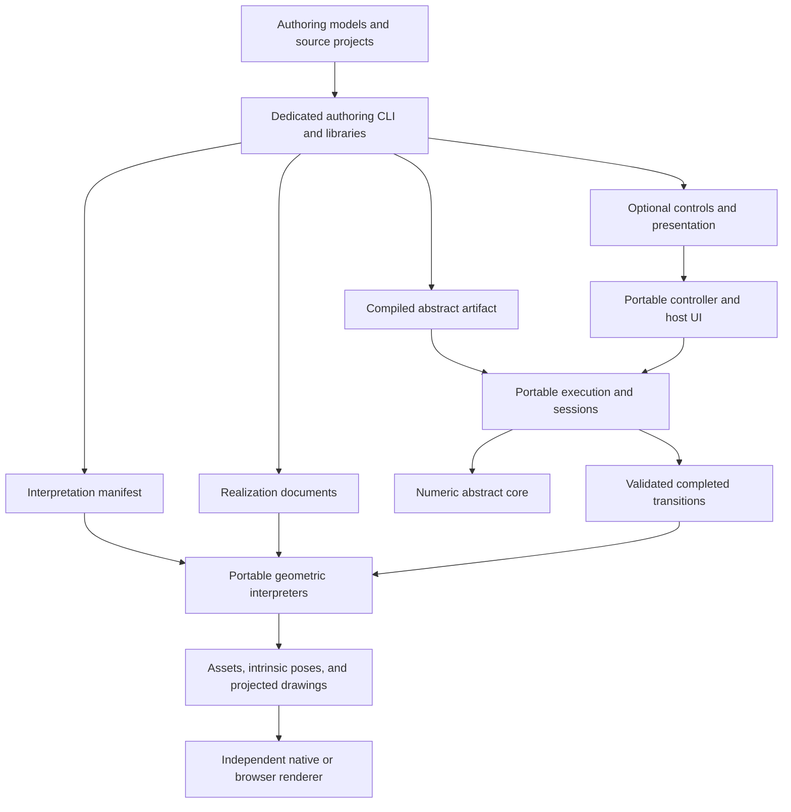

# Architecture review: authoring tools and interpreter contracts

Reviewed against the workspace code on 2026-10-31. This is a proposed design and
implementation plan; the proposed artifact formats are not yet implemented by
the runtime.

Phase 1 now has [draft contracts and acceptance gates](contracts/authoring-runtime.md),
structural/hash conformance checks, and a frozen native/WASM baseline across seven
puzzle families. [Initial measurements](contracts/baseline-measurements.md) record
the method and observations. Run `npm run check:architecture` to verify the baseline;
the new artifact loader and runtime separation remain subsequent phases.

The recommended direction is to introduce a dedicated authoring CLI, backed by
reusable compiler libraries, that emits validated runtime artifacts. Preserve
the numeric abstract executor and the geometric interpreters as separate
components of the portable kernel. Establish the boundary through versioned
data contracts and shared validation code before moving directories or removing
source imports from the reference application.

The project already has the difficult part: an independent abstract executor,
exact completed transition witnesses, and renderer-independent geometry. The
largest improvement is to finish the separation between authoring and runtime
loading. A second improvement is to replace conventions embedded in movement
names with explicit bindings. Neither requires changing the puzzle mathematics.

**Current structure and evidence.** The current inventory contains 24 puzzles,
48 realizations, and 17 generator entry points. Public kernel API 7 exposes
source formats 1–3, session schema 2, geometry API 1, and independently versioned
pose and mesh buffers.

| Component | Current responsibility | Assessment |
| --- | --- | --- |
| [`puzzle_core`](../include/twisty/core.hpp) and [`transports.cpp`](../src/transports.cpp) | Numeric states, choices, predicates, finite actions, transports, validity, goals, and transition planning | Strong boundary. `core::Program` has no JSON, geometry, DOM, or renderer dependency. Preserve it. |
| [`puzzle_language`](../include/twisty/authoring/compiler.hpp) | Source lowering, compact declarations, Cube/Gear factories, inspection, completion policy, and discovery | Compiler and runtime completion data share a library and public header. Split these responsibilities without duplicating evaluation. |
| [`Execution`](../src/execution.cpp) | Source loading, compilation, symbolic state mapping, inverse/event bindings, interpreter catalog construction, controls, and canonical digests | Main integration seam. Its runtime behavior currently depends on authoring source and adapter conventions. |
| [`Session`](../include/twisty/session.hpp) | Revision-checked mutation, history, replay, notation, and scramble | Appropriate portable runtime responsibility. Keep revision and replay semantics. |
| [`ControlCatalog`](../src/controller/catalog.cpp) and [`Controller`](../include/twisty/controller.hpp) | Authored phase readers, family routes, completion tuples, destination queries, and checked commands | Sound placement outside the core. Catalog compilation reads source profiles; piece-to-family selection also reads source moves for per-piece support. |
| [`GeometryDefinition`](../include/twisty/geometry.hpp) and private [geometry compiler](../src/interpreter/geometry_compiler.hpp) | Realization validation, meshes, placement frames, motion tracks, intrinsic poses, and projections | Good renderer boundary. Geometry retains an `Execution` for state and witness validation; that is useful, but currently brings the compiler dependency with it. |
| [`scripts/`](../scripts/puzzle-inventory.json) | Python model construction, meshes, package export, subprocess orchestration, pins, and provenance | A substantial authoring system already exists, distributed across scripts rather than exposed as one tool. |
| [`kernel/index.ts`](../kernel/index.ts), [`bindings.cpp`](../src/bindings.cpp), and [CMake targets](../CMakeLists.txt) | Independent native/WASM access and packaging | Useful consumer checks exist. The default WASM module and umbrella target currently include authoring factories and compilation. |
| [`web/src/App.tsx`](../web/src/App.tsx) | Reference UI, preset loading, commands, views, and puzzle-specific presentation | Correctly outside the kernel. Some family/name conventions and Gear generation remain embedded in the application. |

`language::Puzzle` already exposes general finite relations independently of the
more restrictive session/interpreter adapters. Do not confuse restrictions of
`Execution`'s supported binding catalogs with restrictions of `core::Program`.

**Improvements, in priority order.**

| Priority | Finding in the current code | Proposed improvement and benefit |
| --- | --- | --- |
| P1 | `Execution::from_source()` recompiles both packages and persisted `relational-definition` documents. It moves out `source`/`catalog`, invokes `language::compile()`, and compares the rebuilt definition. | Add a genuinely source-free executable artifact and validating loader. Runtime consumers can load puzzles without compiler/factory code or the authoring AST. Keep source recompilation as an authoring parity check. |
| P1 | `Profile`, `Bindings`, and `CompiledPuzzle` live in `authoring/compiler.hpp`; `completion.hpp` includes it. `puzzle_execution` links `puzzle_language`. `ControlCatalog::compile()` reads source profiles/domain order; `Controller::read_families_for_pieces()` reads `canonical.source.domains[].moves` for transport and piece scopes. | Move immutable runtime program/binding/completion descriptors into compiler-independent headers and libraries. Resolve controller routes and local movement support against those descriptors. The compiler becomes a producer of the same runtime data the loader consumes. |
| P1 | Uniform adapters require the local movement name to equal the request ID. Cube support uses family substrings in cell names; cube geometry derives its axis from face letters and direction from `.counterclockwise`. | Export explicit request/local-choice/event/transport bindings, selected support, and geometric track parameters. Keep these conveniences in authoring adapters. Renaming a label must not change motion or permission. |
| P1 | One `definitionDigest` covers program, source, symbolic bindings, catalog, and controls. Geometry pins and saved sessions both use it. | Define separate execution, interpretation, control, realization, and provenance identities, with precise dependency rules. Presentation edits should not invalidate logical history. Migrate deliberately; do not reinterpret existing hashes. |
| P2 | `build:puzzles` builds native tools and orchestrates generators, but its native validation callback only returns a digest. Full interpreter construction happens in the WASM `check:puzzles` gate. | Give the dedicated tool native access to the same geometry validators and require every declared realization to pass before publishing a build manifest. Preserve the WASM gate as cross-platform verification. |
| P2 | Realization kinds/capabilities appear in JSON schemas, C++ dispatch, `kernel_info()`, and TypeScript unions. Geometry compiler dispatch uses several kind flags. | Establish one contract catalog for version/capability identifiers and conformance fixtures; add independent backend registration behind the existing API. Require schema/API/implementation agreement. Start with static registration. |
| P2 | `build:kernel` and the WASM module include authoring facilities; the SDK packager checks the repository's entire puzzle inventory and ships source examples and all presets. | Offer runtime and authoring entry points/build profiles. Make fixture packages optional for a minimal runtime distribution, while retaining the existing complete SDK during migration. |
| P3 | The reference app detects puzzles and operation spellings to choose controls, shortcuts, examples, and angles. | Put optional labels, notation aliases, shortcut bindings, examples, and control/view hints in presentation metadata. Select reusable UI components through declared capabilities. |

These are architectural findings, not a claim that current loading or animation
is unsafe. For example, recompilation currently provides a strong consistency
check, and geometry performs endpoint certification. The replacement must retain
those guarantees through independent validation.

**The proposed dependency direction.** Authoring remains in the same repository
initially, with a distinct command and package boundary. A separate service or
repository would add release and deployment coordination before the contracts
are proven. A GUI can later wrap the same command/library APIs.

The diagram describes data production and consumption. A geometric interpreter
may retain a read-only runtime validator to check imported states and witnesses;
it must not mutate a session or introduce geometric permission rules. The core
must not depend on the compiler, manifests, coordinate spaces, or interpreters.
Renderers and host UI continue to own camera controls, gestures, animation
scheduling, easing, Three.js, React, and DOM access.

Runtime libraries should form the dependency chain `core` → compiled data and
completion → execution/session, with optional controller and geometry consumers
above it. The source compiler depends on the compiled data contract and the core,
and the authoring CLI additionally invokes interpreter validation. There must be
no reverse link from runtime loading to source compilation. Preserve a separately
usable native/WASM compiler SDK; isolating authoring must not make the compiler
available only through a subprocess or reference application.

**The dedicated authoring tool.** Introduce a proposed `twisty-author` CLI with
`build`, `check`, `inspect`, and `validate` commands. Initially implement its
orchestration in Python, matching the existing generators, and call narrow C++
compiler/validator executables where needed. The name is illustrative. Keep all
permission and geometric certification implementations in the reusable C++
libraries; the CLI should orchestrate them rather than create another evaluator.

- A project declares its logical source or model generator, realization inputs,
  optional controls/presentation, and outputs. Existing Python model algorithms
  remain usable through adapters during migration.
- `build` generates candidates in a staging directory, compiles the logical
  artifact once per puzzle, validates bindings and every realization, then
  publishes an output set and manifest. Failure leaves the previous complete
  output set available. Use a versioned staging directory and manifest switch
  rather than treating an individually atomic manifest rename as a transaction
  for all files.
- `check` verifies freshness, determinism, contract compatibility, and native/WASM
  conformance without rewriting files or fixture pins. Preserve today's explicit
  fixture-pin update behavior and review requirement.
- `inspect` reports artifact versions, counts, capabilities, IDs, and compatibility
  hashes. `validate` can check an independently supplied artifact/realization pair
  without accessing the original project or generators.
- Producer provenance records input hashes, generator/compiler versions, and
  output hashes separately from runtime compatibility. Use per-project dependency
  manifests so an unrelated source edit does not require every puzzle to be
  regenerated. Retain a whole-inventory audit for release checks.

Start with a CLI and reproducible artifacts. Interactive parameter editing,
physical modeling, distributed generation, and a new authoring language are
separate extensions.

**The contract should have two parts.** The first is between the source compiler
and the abstract runtime. The second is between authoring output and geometric
interpreters. Keeping them distinct allows a valid logical puzzle to run headless
without an available realization.

| Proposed artifact | Required contents and consumer | Excluded responsibilities |
| --- | --- | --- |
| Compiled abstract artifact | Numeric program, initial placements, predicates/goals, compact transports, stable symbol-to-index tables, event identities, completion tuples/conditions, and inverse mappings; loaded by portable execution | Source AST, meshes, coordinates, angles, cameras, or UI labels |
| Interpretation manifest | Explicit piece/domain/placement/port/resource correspondences and event-to-transport certificates; validated against the abstract artifact and consumed by interpreters | New legality predicates or geometric guesses about which pieces participate |
| Realization document | Interpreter kind/version, required capabilities, intrinsic space, placement frames, visual parts/assets, material/port bindings, and event/path tracks | Authority to permit an abstract request or change a logical state |
| Optional controller artifact | State-backed phase readers, stable family/stop/path IDs, resolved request/completion routes, inverse-route consistency, and controller behavior identity | Camera/input handling or angle-based legality |
| Optional presentation document | Labels, notation aliases, shortcuts, example algorithms, and view/control hints; references stable IDs | Logical identity or an additional rules evaluator |
| Build manifest | Component hashes, compatibility dependencies, producer provenance, and output inventory | Proof that physical collision constraints or reachability are complete |

The compiled abstract artifact must export every runtime requirement. Moving only
`ProgramData` is insufficient: defaults, profile availability, local inverses,
symbolic state encoding, and event identities are needed for current session
behavior. Discovery and completion remain services around the same core planner.
Do not serialize derived acceleration caches or a C++ object memory image.
Keep general core loading available without the optional session, inverse,
controller, or interpretation capabilities. A general finite relation must not
become invalid merely because it has no inverse route or drawable realization.
Consumers requesting those capabilities must validate their complete sections.

Use explicit JSON as the first portable artifact encoding. Specify integer ranges,
array order, index spaces, sentinel representation, canonical hashing, duplicate
handling, unknown fields, and resource limits. Round-trip the same payload in C++
and WASM. A later binary encoding can preserve the same semantic model with its
own version and documented byte layout. The existing inspection preview is useful
input to this work, but is not yet a stable executable serialization format.

The proposed loader parses and bounds allocations, constructs `core::Program`
through its existing validation path, then validates completion predicates and
tuples, inverse tables, symbol mappings, and all cross-references. A claimed hash
or a successful JSON Schema check never substitutes for these checks. Expensive
generation and source lowering disappear from loading; structural and semantic
validation remain.

**The interpreter contract in detail.** An implementation should be able to
consume an abstract artifact, an interpretation manifest, and a realization
without reading authoring source, executing Python, or recognizing a puzzle ID.
Each reference must declare whether it is a stable ID or an artifact-local index;
never infer correspondence from sorted labels or matching array positions in
independently produced files.

1. **Identity and coverage.** Resolve every referenced piece, placement, port,
   request, local choice, and event against the artifact. Require complete coverage
   for the declared interpreter scope and reject contradictory bindings. A loader
   may explicitly advertise a subset of supported events; it must reject animation
   outside that subset before changing presentation state.
2. **Resting frames and assets.** Declare intrinsic dimension, coordinate model,
   metric, matrix convention, and ownership. Cover every placement for each bound
   component. Keep local mesh scale separate from intrinsic isometries. Preserve
   R³, spherical, quotient-surface, and S³/SO(4) distinctions; avoid assuming every
   4×4 matrix is a homogeneous Euclidean transform.
3. **Participation and paths.** Bind each event within its declared domain or
   participant scope to the exact abstract transport and an explicit geometric
   path selector. Preserve stationary pieces, moving pieces, self-loop
   participants, and unavailable interpreter sections as distinct cases. An
   unavailable section is metadata for a certificate; only abstract relations and
   invariants decide permission.
4. **Endpoint certification.** Check each applicable transport row against the
   target placement frame and labeled ports, modulo only declared component
   symmetries or quotient identifications. Specify per-space tolerances and test
   them in native/WASM. Keep validation independent of the author's claimed
   certificate and include rejection tests with deliberately wrong endpoints.
5. **Path identity.** Explicitly represent signed angles, winding, local/world
   pivots, ordered steps, and shared family generators. Equal endpoints do not
   determine a path: a full turn or a Gear edge's longer winding still matters.
   Do not reconstruct motion from endpoint matrices or movement spelling.
6. **Witness validation.** Retain current `GeometryDefinition::animate()` behavior:
   replan the recorded completed choices through the abstract executor, compare
   the full state/action/event witness, and resolve certified tracks. Extract a
   reusable runtime witness validator if that narrows the geometry dependency.
   Dropping validation to make geometry look independent would weaken the design.
7. **Evaluation and failure.** Resting evaluation and seeking must be deterministic
   and independent of previous samples. Failure must preserve the live session
   and displayed frame. Prepared animations, frames, and drawings keep their
   documented shared/owned lifetimes. Keep scheduling and easing in the host.

The artifact is a contract with the interpreter's validator, not an instruction
to trust the authoring tool. Endpoint/port consistency also does not prove
collision-free motion, mechanical realizability, or full reachability. An authoring
model may derive finite abstract guards from geometry, but the emitted guards
must be explicit and the runtime must evaluate them in the abstract core.

An illustrative event binding could be `{eventId, domainId, localChoiceId,
transportIndex, pathId}`. `transportIndex` belongs to the pinned abstract artifact;
`pathId` resolves in the selected realization. The final schema must make
source-dependent/component path selection explicit where required. Existing
articulated event certificates, `motionFamilies`, shared rotation tracks, and
transport-region selectors provide the starting implementation; a new universal
motion language is unnecessary for the first release.

**Movement identifiers and names.** Retain stable internal IDs for requests,
domain-local choices, events, control families/stops, and paths. They can be opaque
strings. Display names and notation aliases become optional presentation data.
Existing values such as `R`, `UF_ab`, and `R.clockwise` can remain stable IDs during
migration; changing every ID now would create unrelated compatibility work.

Keep three family concepts explicit: an abstract reference twist family describes
transport construction; a controller family groups phase/destination routes; a
geometric motion family shares a rotation generator and coordinates. Their IDs
may be associated through explicit bindings, but matching names must not imply
that they are interchangeable.

A command still records its resolved request and completed local choices. Aliases
are resolved before execution, and history stores IDs rather than labels. Numeric
indices are stable only within the artifact that defines their ordering. Renaming
a display label should preserve execution identity; replacing stable IDs requires
an explicit migration. Do not promise canonical equivalence for every differently
authored but mathematically equivalent Boolean program.

**Version and hash policy.** Specify these as separate compatibility dimensions;
they should not all advance when the authoring tool changes.

| Identity/version | Proposed dependency and effect |
| --- | --- |
| Source language and producer version | Authoring/compiler concerns; provenance and diagnostics. Not required by the source-free loader. |
| Abstract artifact format and required capabilities | Exact executable encoding and supported operations. Unknown required capabilities fail explicitly. |
| `executionDigest` | Canonical program, initial state/goals, stable runtime symbols/events, completion/default policy, and inverse mappings. Saved logical history pins this identity. Exclude geometric bindings and presentation. |
| Interpretation contract version and `interpretationDigest` | Pins `executionDigest` plus the complete piece/placement/port/resource/event/transport correspondence. Realizations pin this identity. |
| Controller format and `controlDigest` | Pins `executionDigest` plus phase readers, resolved routes, and preferred-path policy. UI routing changes do not silently change saved logical history. |
| Realization format/backend version and `realizationDigest` | Pins `interpretationDigest`, space semantics, assets, frames, tracks, required capabilities, and any referenced controller layout contract. Invalidates geometric caches. |
| Kernel API and pose/mesh/drawing buffer versions | Consumer compatibility. Preserve their independence from puzzle artifact versions and hashes. |
| Build/output content hashes | Detect byte changes, including labels and provenance, without claiming changed logical behavior. |

All canonical hash rules must be versioned and implemented in shared code. Define
exact treatment of optional fields and floating-point serialization before using
the new hashes as compatibility promises. The new execution hash is structural,
not a proof of mathematical equivalence. A realization with control-layout hints
must also pin the applicable control identity; standalone geometry need not
require a controller artifact.

Keep existing `definitionDigest` and session schema 2 behavior intact for existing
formats. Add an explicit new artifact kind and a versioned save representation
when adopting `executionDigest`. A converter can load an old matching definition,
verify history with recorded choices, map stable IDs, and emit a new save. Until
that converter is proven, require matching old definitions rather than silently
accepting mismatched saves. Presentation camera/view persistence also needs its
own documented fallback when the referenced realization changes.

**Implementation sequence and acceptance gates.** Treat the following as
separately reviewable changes. The first working slice should be a source-free
Cube/Bandage artifact and interpreter pair, before moving all generators.

1. **Freeze the baseline and specify the contracts.** Record native/WASM behavior,
   canonical definitions, completed witnesses, save/replay, and geometry endpoints
   for representative Cube, Bandage, Helicopter, Gear, Melty, flat, and S³ cases.
   Draft compiled-artifact, interpretation, control, and realization compatibility
   schemas plus hash/error rules. Document them in `docs/kernel-api.md` when they
   become public. Measure load time, peak memory, output sizes, and WASM size;
   the review's observed source sizes are not performance measurements.
   Acceptance: agreement on responsibility/identity tables and reusable fixtures,
   with existing behavior unchanged.
2. **Extract runtime descriptors and completion.** Move compiler-independent
   descriptors into proposed `runtime.hpp`/`artifact.hpp` headers and a runtime
   data library. Have `language::compile()` produce them. Separate completion and
   discovery from source compiler implementation; resolve controls and
   piece-to-family support through compiled bindings. Maintain source-facing
   convenience APIs through a separate
   adapter. Acceptance: runtime descriptor consumers compile without including
   `authoring/compiler.hpp`; source-compiled behavior and witnesses stay equal.
3. **Implement the source-free loader and vertical slice.** Add the versioned
   artifact reader/writer and all validation, then expose shared immutable
   artifact construction to native/WASM sessions. Produce Cube and Bandage with
   complete runtime bindings and parity checks. Acceptance: an external consumer
   executes, saves, replays, and animates with no source AST or authoring libraries;
   malformed programs/bindings fail atomically. Source and compiled loaders produce
   matching normalized outcomes. New-format hash migration is explicit.
4. **Make interpretation bindings explicit.** Lower cube face-letter/suffix
   conventions in authoring; remove request/local-move name equality as a runtime
   assumption. Introduce the interpretation manifest and adapt existing geometry
   compilers to it. Cover Helicopter phase-dependent events, Gear per-domain
   events/winding, and independent Melty caps before declaring the contract
   general. Then cover quotient and S³ spaces. Acceptance: label/alias changes
   preserve behavior; all 48 current realizations pass declared coverage and
   endpoint checks; forged witnesses and missing tracks remain rejected.
5. **Consolidate authoring behind the dedicated tool.** Add project manifests,
   CLI commands, staging, reproducible export, and native realization validation.
   Wrap existing generators first, then relocate model/mesh exporters under a
   proposed `tools/authoring/` package and remove hard-coded `build/native` paths.
   Keep reusable C++ compiler code separately linkable. Existing npm commands
   become compatibility wrappers. Acceptance: the same project builds outside
   the source tree with explicit tool paths; failed generation preserves prior
   outputs; `check` is read-only; one-project rebuilds have bounded dependencies.
6. **Split distributions and migrate the reference app.** Add a compiler-free
   runtime CMake target/profile and WASM entry point, plus an optional authoring
   SDK/module with matching declarations. Retain the current complete umbrella
   during a documented compatibility period. Update independent installed native,
   Node, and canvas consumers. Load reference presets from runtime artifacts;
   keep browser Gear construction/source import behind an explicitly loaded
   authoring module. Acceptance: consumer packages work with authoring inputs and
   generators absent; link/symbol checks reject compiler/factory dependencies in
   the runtime profile; existing source workflows remain supported by the SDK.
7. **Finish extension and presentation cleanup.** Register geometry backends
   through a small internal descriptor/validator/compiler interface with explicit
   versions and capabilities. Consolidate contract identifiers and conformance
   fixtures. Move UI labels/aliases/hints out of movement IDs and puzzle-specific
   branches where a reusable capability exists. Acceptance: a new backend or
   presentation label does not require changes to the abstract executor; an
   independent consumer can discover support without importing the reference UI.

Steps 2 and 3 are prerequisites for a compiler-free runtime. Moving directories
alone does not achieve that separation. Step 4 can reuse existing runtime
geometry preparation; serializing private `GeometryProgram` caches or baking
every projection is not required. Consider a separately versioned prepared
geometry cache only if measurements show a worthwhile cost reduction.

**Required verification for the implementation.** Preserve current parity,
controller, geometry, fixtures, and independent-consumer checks; extend them at
the new boundary instead of replacing them with exporter snapshots alone.

- Test core-only, runtime-only, and optional authoring native link profiles. Extend
  `tests/runtime_boundary.py`: it currently excludes retired evaluator symbols,
  but does not assert that current compiler/factory symbols are absent.
- Round-trip artifact bytes and canonical hashes in native/WASM; compare source
  compilation with direct artifact loading on the same bounded scenarios.
  Exercise unknown versions/capabilities, invalid references, count overflows,
  malformed predicates/transports, invalid completions/inverses, and wrong pins.
- Test geometry independently of the reference app: all declared coverage, wrong
  endpoint/port certificates, forged witnesses, self-loop participation, full
  winding, multi-component events, local/world motion, quotient identifications,
  and S³ space/buffer interpretation. Preserve seeking and object-lifetime checks.
- Test that geometry/view/label edits preserve execution identity, while program,
  completion, inverse, or stable runtime identity changes invalidate it. Exercise
  old/new save conversion and matching-old-definition behavior explicitly.
- Test deterministic generation, staged failure, project-local freshness, and
  installed consumers with the original repository/generators unavailable. Track
  cold load time, peak memory, and distribution size without promising gains
  before measurement.

The workspace's 4 GiB limit remains applicable: generation, builds, and browser
checks run sequentially; builds use one or at most two jobs; browser checks use
one headless worker with display variables unset. No deployment or Dockerfile
change is needed for this architecture work.

**Review validation and limits.** This review traced build targets, public
headers, source loading/lowering, controller compilation, geometry preparation
and witness validation, schema/SDK declarations, package generation/provenance,
and installed consumer checks. The targeted native build used one job. All seven
selected native baseline checks passed: `family_controller`, `finite_actions`,
`geometry_api`, `runtime_has_no_legacy_backend`, `core_relations`,
`sessions_and_interpreters`, and `portable_fixtures`. These checks validate
existing behavior; they do not test the proposed artifact contract. Browser
checks and the full independent-consumer packaging check were inspected but were
not executed for this documentation change.
The review does not establish physical correctness of every puzzle or a measured
startup/size regression. The review does not implement the proposed runtime
loader or migrate puzzle artifacts; the Phase 1 checks are linked above.
