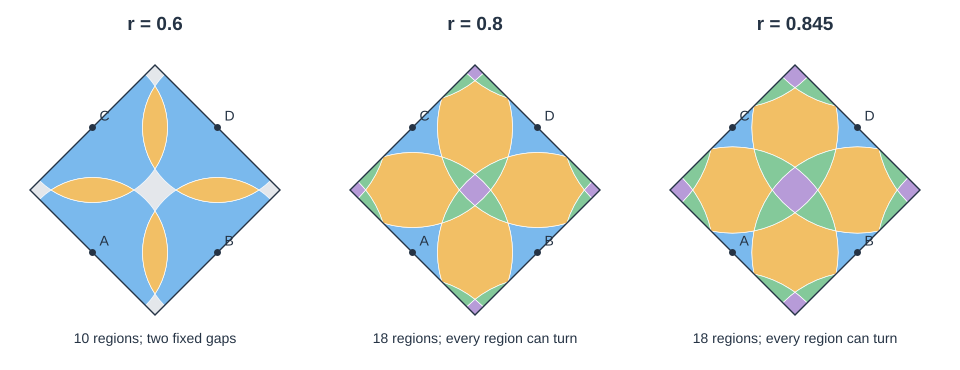

# Four-disk puzzle on the flat pillowcase (2222)

The proposed four-cone construction gives a valid finite puzzle. Equal cutting
radii in `1/√2 < r < 1` produce 18 piece regions and four involutory moves. The
fully labeled, orientation-sensitive version has exactly 384 reachable states,
and its move graph has diameter 12. This makes it a compact puzzle rather than
a large permutation puzzle. Radius changes within that interval preserve its
move system.

The four-disk radius-0.846 candidate and the equal-radius six-disk 0.6
candidate are now implemented as `flat-pillowcase` and `flat-pillowcase-6`.
Both have geometric realizations and fundamental-domain/tiled-plane views,
including the independent Canvas client. The analysis below records their
construction; the mixed-radius 42-region alternative remains an investigation.

## Geometry and units

Start with the square torus `R² / (2Z)²` and take its quotient by

```text
I(x,y) = (1-x, 1-y) modulo 2.
```

Its fixed points are the existing square-grid cutting centers:

```text
A=(0.5,0.5)   B=(1.5,0.5)
C=(0.5,1.5)   D=(1.5,1.5).
```

Each becomes a cone point of order 2, with angle π. A fundamental domain is
the square `|x-1|+|y-1| ≤ 1`, whose side length is √2 and whose area is 2. Its
edge midpoints are A–D; pair the two halves of each edge by a half-turn about
that midpoint. All four vertices identify to one regular point. This is the
usual [pillowcase orbifold](https://ornl-ndav.github.io/ortep/topology/orbfld2.html),
also represented by two unit squares glued along their boundaries.

All radii below use nearest-cone distance **1**. If the displayed fundamental
square instead has side length **1**, divide these radii by √2. For example,
`r=0.846` here becomes approximately `0.598` in that convention.

## Radius intervals and piece counts

Lifts of the four cone centers together form the unit square lattice. The
geodesic disk about a cone lifts to ordinary circles about the corresponding
center orbit, with opposite points identified by the stabilizing half-turn.

| Radius | Arrangement on the pillowcase | Inter-piece motion |
|---|---|---|
| `0 < r < 1/2` | 4 separate cone disks and 1 connected exterior region | No exchange between disks |
| `1/2 < r < 1/√2` | 4 centers, 4 edge lenses, 2 uncovered gaps: **10 regions** | The gaps remain fixed |
| `1/√2 < r < 1` | 4 centers, 4 edges, 8 three-disk lobes, 2 four-disk cores: **18 regions** | Every region participates in a turn |

The first transition occurs when disks at neighboring centers, distance 1
apart, touch. The second occurs when diagonal centers, distance √2 apart,
touch and the four nearest boundaries meet at a square-lattice vertex. Above
that second transition the disks cover the whole surface.

These counts also follow independently from the circle graph on the underlying
sphere. In the smaller overlapping regime, four neighboring pairs of circles
have two crossings each, giving `V=8`. In the larger regime, two diagonal pairs
each add four crossings, giving `V=16`. The graph is connected and four-valent,
so `E=2V` and Euler's formula gives `F=V+2`: 10 and 18 regions respectively.

Avoid the exact tangencies `r=1/2` and `r=1/√2`. At `r=1` a disk reaches other
cone points and meets another lift of itself. The ordinary single-cone disk
rotation construction requires the strict upper bound `r<1`.

## Turns and reachable states

Use a 90° rotation in the Euclidean lift. The square lattice and complete
circle arrangement are invariant under those rotations. For each named disk,
all of its translated lifts are disjoint when `r<1`, and the lifted rotations
commute with the quotient half-turn. Consequently the complete motion, and
not only the endpoint permutation, descends to the pillowcase. Other cone
points stay outside the rotating disk.

A 180° lifted rotation is already the identity on a cone disk. Thus a 90°
lifted turn is a half-turn intrinsically, and

```text
A² = B² = C² = D² = identity.
```

Clockwise and anticlockwise versions have the same endpoint, but trace
different animation paths. They may be represented by separate requests and
motion events with the same abstract transport, as the current language allows.

In the 18-region arrangement each basic turn:

- rotates its own cone-center region in place;
- exchanges two edge regions;
- exchanges six lobes in three pairs;
- exchanges the two cores.

The quotient placement catalog has 8 placements in each of the four families:
32 placements for 18 pieces. A center has two orientation states, an edge has
two orientations at each of its four locations, a lobe has eight locations,
and a core has four orientations at each of two locations.

Breadth-first enumeration of the complete marked state graph gives:

| Arrangement | Reachable marked states | Move graph diameter |
|---|---:|---:|
| 10 regions, with the two gaps fixed | 192 | 8 |
| 18 regions | 384 | 12 |

The enumerator also computes the full group action on placements and verifies
that the marked initial pieces distinguish every group element. The diameter
therefore follows from the largest distance from the solved state. Counts
assume fixed labels A–D, distinct piece identities, and distinguishable allowed
orientations. Less detailed coloring can identify states and reduce the visible
state count. Increasing the radius within one interval cannot increase it.

## Choosing a radius



Blue denotes cone-center regions, orange edges, green lobes, purple cores,
and gray uncovered fixed regions. The drawings show cuts in one fundamental
domain; seam fragments can belong to the same physical piece.

The existing torus value `r=0.8` works. A value around `0.846` improves the
smallest region areas while retaining space around each cone. The following
areas are per physical region; the whole pillowcase has area 2. They are
computed from circular arcs, including the circular-segment correction to the
sampled boundary polygons.

| Radius | Center | Edge | Lobe | Core |
|---|---:|---:|---:|---:|
| 0.750 | 0.1452 | 0.3297 | 0.0108 | 0.0072 |
| 0.800 | 0.0885 | 0.3343 | 0.0303 | 0.0333 |
| 0.840 | 0.0551 | 0.3152 | 0.0481 | 0.0673 |
| 0.845 | 0.0515 | 0.3116 | 0.0504 | 0.0723 |
| 0.850 | 0.0481 | 0.3077 | 0.0527 | 0.0776 |
| 0.900 | 0.0208 | 0.2558 | 0.0768 | 0.1396 |

Center and lobe areas coincide near `r=0.845980`. This supplies a useful
area-balancing choice, rather than a guarantee about preferred visual widths
or picking comfort. Near `1/√2` the new regions are tiny; near 1 the center
regions become tiny. Suggested first prototypes are `r=0.8` for comparison
with the torus and `r≈0.846` for a more balanced layout.

## Adding disks at the domain center and vertices

Two additional disks are compatible with the original four. Let `E=(1,1)` be
the fundamental square's center and `F=(1,0)` one of its vertices. All four
vertices represent the same ordinary point, so this adds exactly two disks.
Both centers are regular points, with no cone singularity.

Their lifts are the two checkerboard classes of the integer lattice:

```text
E: (m,n) with m+n even
F: (m,n) with m+n odd.
```

A 90° turn about any cone center exchanges these two classes. Therefore choose
the same radius `s` for E and F to retain all four original turns. A 90° turn
about an integer center preserves each checkerboard class and the half-integer
cone-center lattice. With equal radii within each family, all six turns
preserve the complete lifted cutting arrangement at their endpoints.

The extra disks need a smaller radius than the cone disks. The nearest other
lift of either new center is distance √2 away, and the nearest cone is distance
`1/√2` away. Thus the embedded ordinary-disk construction requires

```text
0 < s < 1/√2.
```

Their lifted supports are disjoint within each center orbit in this range, so
the rotations descend throughout the motion. Unlike the cone-centered turns,
the new disks have no stabilizing half-turn: their 90° turns have order 4.

One concrete interacting candidate is:

| Disks | Radius | Lifted turn | Order |
|---|---:|---:|---:|
| A, B, C, D at the cones | 0.846 | 90° | 2 |
| E at the center, F at the vertices | 0.600 | 90° | 4 |

Taking `s>1/2` also makes E and F overlap. At the tabulated radii, their
boundaries cross the original cuts, so the extra moves can exchange pieces
between the original regions. If the fundamental square has side length 1,
the same candidate uses approximately `0.5982` and `0.4243` respectively.

An independent circle-intersection calculation finds 40 ordinary transverse
crossings on the pillowcase: 16 between cone cuts, 8 between E and the cone
cuts, 8 between F and the cone cuts, and 8 between E and F. It checks that
there are no triple crossings at these radii. The connected cut graph is
four-valent, so Euler's formula gives **42 piece regions**. These are physical
regions after quotienting; displayed vertex copies do not add pieces.

An equal-radius alternative also works: set **all six radii to 0.6**. Then
the combined lifted centers form a square lattice of spacing `1/√2`. The
original cone cuts have 8 crossings rather than 16; the other three crossing
counts remain 8 each, giving 32 crossings and **34 piece regions**. This
changes the original four-disk layout while providing a uniform-radius
six-disk construction. All six cannot retain radius 0.846, because the two
ordinary disks would pass their embedding bound and reach cone points.

The audit script verifies these crossings and all six exact center-lattice
maps. The equal-radius 34-piece variant has a production placement catalog
and geometric realization. Its full state count has not been enumerated.
The mixed-radius 42-piece alternative has no production package. The
384-state enumeration and exhaustive native cross-checks elsewhere in this
report apply specifically to the four-disk candidate.

## Implementation implications

The existing abstract language, compiler, occupancy invariants, session,
history, and exact move executor can already represent this puzzle. The
investigation creates a temporary package with no new abstract rule. Existing
torus transports commute with `I`, and reducing their placement and location
orbits produces the catalog above.

The geometric interpreter and renderers implement the pillowcase extension:

- Canonicalize positions and frames under the half-turn as well as translations.
  A cone-center frame has a nontrivial stabilizer.
- Give a cone-center region a half-domain asset, or another representation
  that avoids coincident copies. Its full planar lift has twice its intrinsic
  area. Orientation markings must descend under the stabilizer; the current
  single asymmetric L on a full center mesh does not.
- Describe the square fundamental polygon and the group generated by two
  translations and the half-turn. The current assumption of two deck
  generators is specific to torus and Klein bottle.
- Keep displayed copies, clipping, recycling and picking in the renderers.
  Adjacent square tiles carry a 180° rotation and preserve handedness.
  The independent Canvas consumer needs the same interpretation.

For an exact tile formula, set `c=(1,1)`, `a=(1,1)`, and `b=(-1,1)`. The tile
at address `(i,j)` is the image of the fundamental square under

```text
g(i,j)(p) = c + i*a + j*b + (-1)^(i+j) * (p-c).
```

For even `i+j` this is a translation in `(2Z)²`. For odd `i+j` it is the
quotient half-turn followed by such a translation. Thus these are actual group
elements, not just copies that happen to fill the viewport.

## Reproduction and verification scope

Run the independent quotient audit, finite enumeration, and radius analysis:

```sh
python3 scripts/pillowcase_investigation.py
```

With an existing native CLI, also check all 384 states and all 1,536 directed
edges against production compilation, invariants, request legality, state
serialization, and transition piece maps:

```sh
python3 scripts/pillowcase_investigation.py --native build/native/twisty
```

Each directed edge is exercised in both directions in an involution loop,
giving 3,072 checked loop transitions. Regenerate the illustration explicitly:

```sh
python3 scripts/pillowcase_investigation.py --svg docs/images/pillowcase-radius-study.svg
```

The script uses only the Python standard library and committed torus data.
The radius-outline helper is shared with square-surface authoring; quotient
canonicalization and state enumeration are independent of its move generator.
It never refreshes the production build manifest or puzzle packages. Native
cross-check packages are created in a temporary directory and removed afterward.
These checks establish the abstract candidate and its intrinsic cut motion;
rendered cone assets, animation canonicalization, picking and browser behavior
are checked by the production native, WASM, and browser suites.
